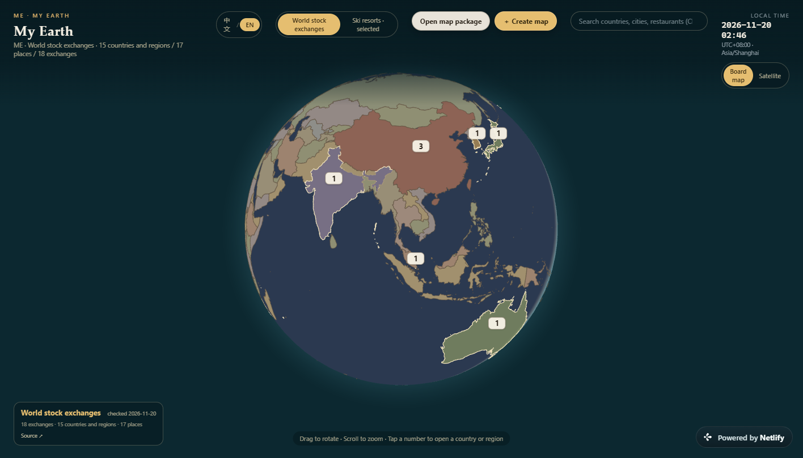
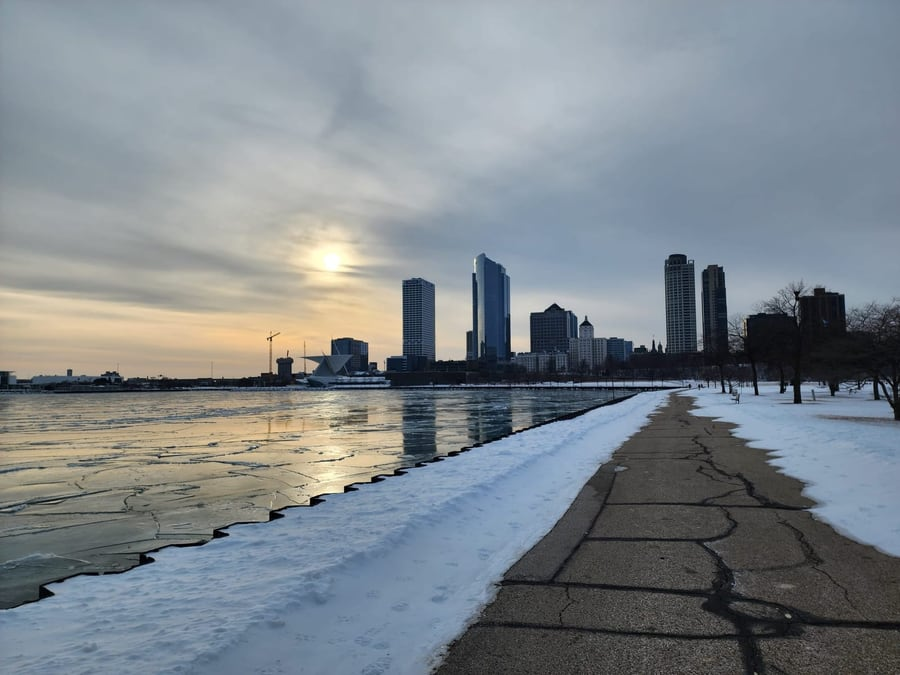
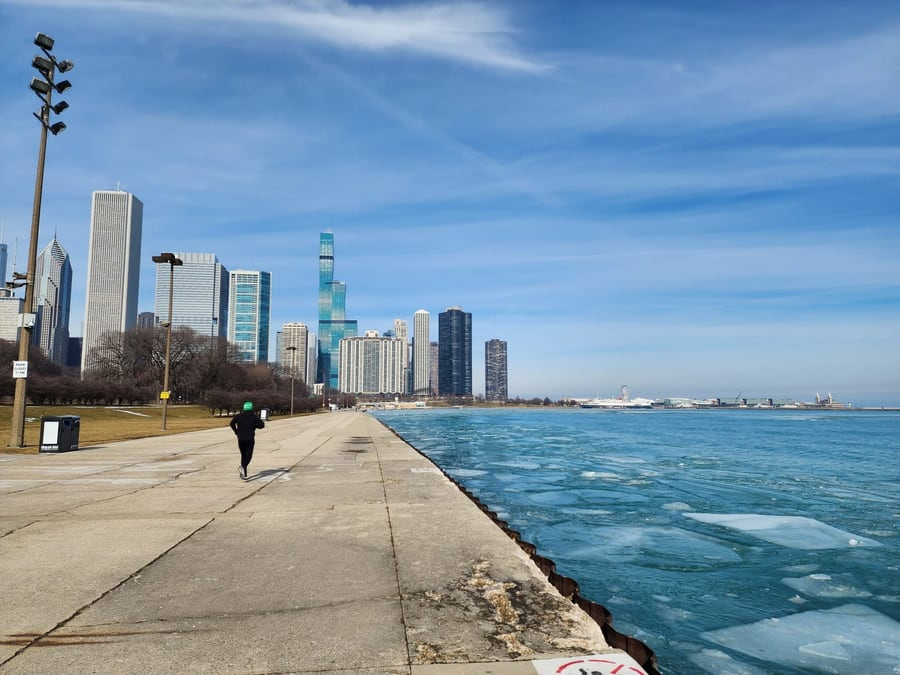
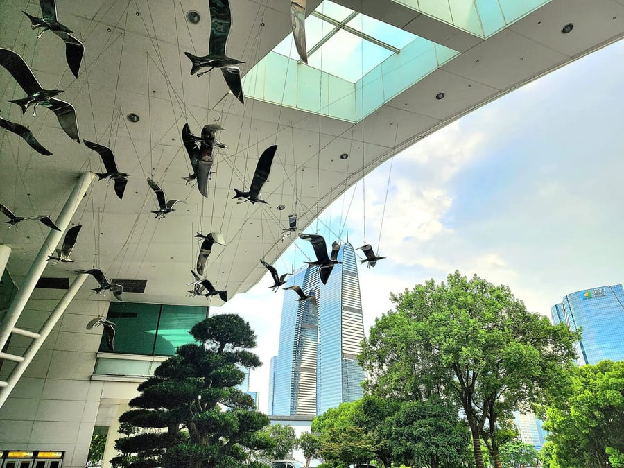
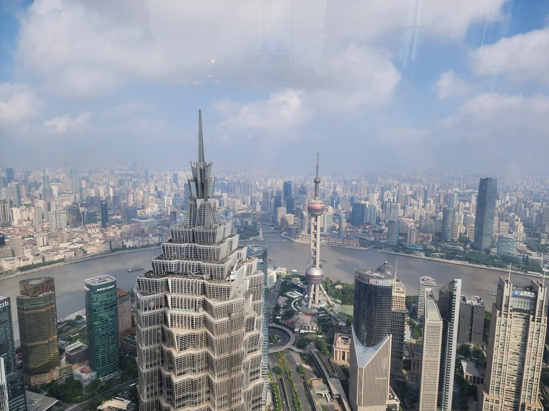
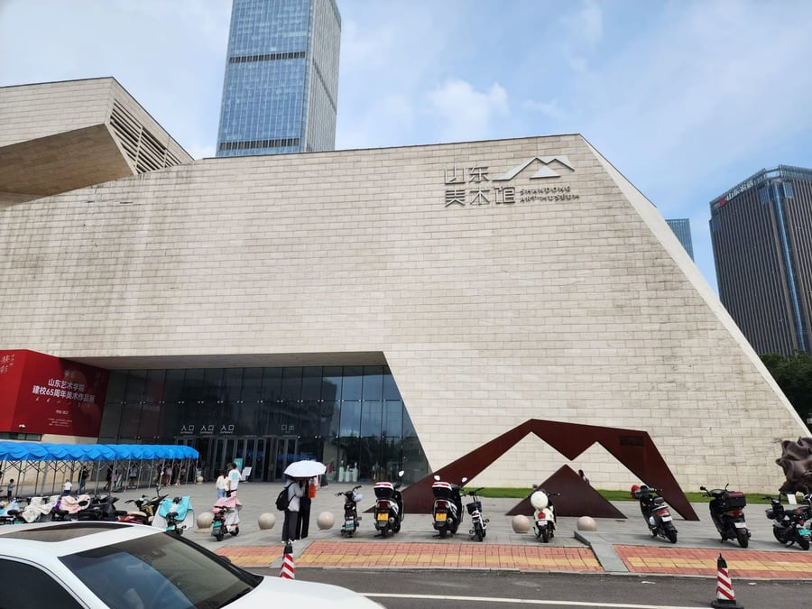
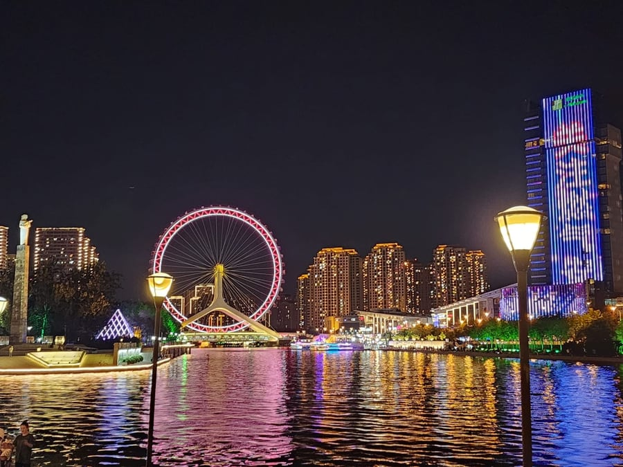
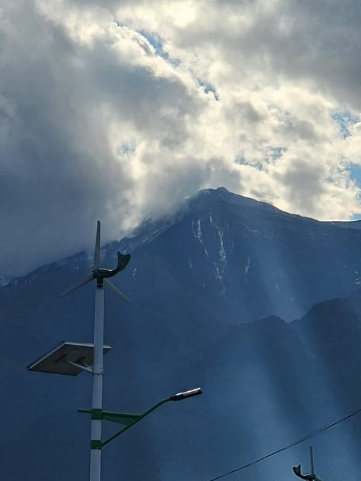
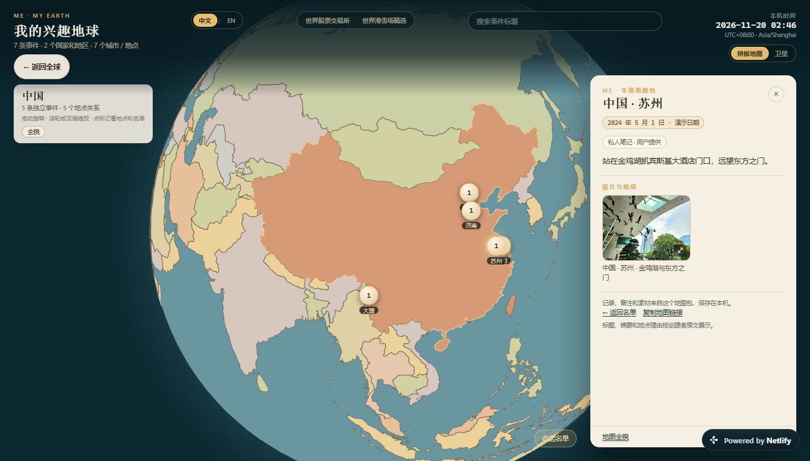

# ME · My Earth

**Turn the places you care about into an interactive globe you can share.**

ME is a bilingual 3D interest globe. The v0.5.0 home page opens on **World stock exchanges**; the second built-in topic is **selected ski resorts**. You can also upload your own CSV/JSON, open a local photo/video map package, or ask an agent to build a map.

**[Live site](https://me-interest-globe.netlify.app/)** ·
**[World stock exchanges](https://me-interest-globe.netlify.app/?topic=world-exchanges&lang=en&welcome=0)** ·
**[Ski resorts](https://me-interest-globe.netlify.app/?topic=ski-resorts&lang=en&welcome=0)** ·
**[Travel photo example](examples/travel-seven/)** ·
**[me-agent 0.5.0](#me-agent-050)** ·
**[Agent workflows](docs/AGENT_WORKFLOWS.md)**

<a href="https://me-interest-globe.netlify.app/?lang=en&welcome=0">
  
</a>

*The v0.5.0 home page: 18 exchanges, official sites and coordinate-precision notes. The second topic is 12 ski resorts. Country browsing stays on the same 3D globe.*

## Start here

| Topic | What is inside | Open |
| --- | --- | --- |
| **World stock exchanges** | 18 exchanges or operating companies, 17 city places, official websites, coordinate-precision notes. The default topic. | [Open](https://me-interest-globe.netlify.app/?topic=world-exchanges&lang=en&welcome=0) |
| **Ski resorts · selected** | 12 resort/village bases in 12 countries and regions; points are bases, not summits. | [Open](https://me-interest-globe.netlify.app/?topic=ski-resorts&lang=en&welcome=0) |
| **My travel fragments** | 7 author-taken photos: Milwaukee, Chicago, Suzhou, Shanghai, Jinan, Tianjin and Dali. Suzhou and Shanghai carry clearly marked demo dates. | [Travel example](examples/travel-seven/) |

Country browsing stays on the globe. Click a country, open a record, then click the sea or blank space outside the globe to return to the world view. A drag keeps the current country and rotates the sphere.

## A public travel example, with real photos

I am publishing seven processed copies of my own travel photos as a ME example. They are included in the downloadable `.mezip` and on this page. **The two short videos from the same private trip are not published.**

<table>
  <tr>
    <td width="33%"><br><sub>US · Milwaukee</sub></td>
    <td width="33%"><br><sub>US · Chicago</sub></td>
    <td width="33%"><br><sub>China · Suzhou</sub></td>
  </tr>
  <tr>
    <td width="33%"><br><sub>China · Shanghai</sub></td>
    <td width="33%"><br><sub>China · Jinan</sub></td>
    <td width="33%"><br><sub>China · Tianjin</sub></td>
  </tr>
  <tr>
    <td width="33%"><br><sub>China · Dali</sub></td>
    <td width="33%"></td>
    <td width="33%"></td>
  </tr>
</table>



*The public package opened in the production viewer: Suzhou photo, confirmed copy and the labelled demo date. The package also includes Shanghai with its own demo date; the other five records have no date.*

**Download the example:** [`travel-seven.mezip`](examples/travel-seven/travel-seven.mezip) (7 records / 7 photos / no video)  
**Open it:** download the `.mezip`, open the [ME viewer](https://me-interest-globe.netlify.app/?welcome=0), choose **Open map package**, then select the file. Photos stay local when the package is opened.

- Suzhou is marked at **Suzhou city level**: “Standing at the entrance of Kempinski Hotel Jinji Lake, looking toward the Gate of the Orient.”
- Shanghai is marked at **Shanghai World Financial Center**: “From the Yue Xuan Chinese restaurant in the Shanghai World Financial Center, looking toward Jin Mao Tower.”
- Only Suzhou (`2024-05-01`) and Shanghai (`2024-05-02`) carry dates, and both are labelled **demo date**. The other five records have no date. The package intro says: “Photos are the author’s own; the dates shown are for feature demonstration only.”

**Attribution and permitted use:** photos © 2026 Sun Junyi. These processed copies are published specifically for this ME travel example and may be downloaded with the example `.mezip`. They are **not CC0**, are **not** covered by the API-example permission, and are **not** part of the code licence. The source files, original filenames, EXIF/GPS and the two private videos are not included.

## me-agent 0.5.0

`me-agent` packs selected photos, short videos and place records into a portable `.mezip`, and can export a 1600×900 PNG for slides. Media stays on your machine; the tool never uploads it.

**Download:** [`me-agent-0.5.0.zip`](https://github.com/junyisunme/me-my-earth/releases/download/v0.5.0/me-agent-0.5.0.zip)  
**SHA-256:** `9247314717631B70484213D4AD147403842391D149886FDA033AED7549AF5525`  
**Viewer:** <https://me-interest-globe.netlify.app/?welcome=0>  
**Guide:** [agent/README.md](agent/README.md) · **Sample:** [agent/examples/japan-cities/](agent/examples/japan-cities/)

### Install

Requires **Node.js 24+**. The versioned installer verifies the Release SHA-256 and preserves existing `out/`, `.mezip`, PNG and media files in the version directory.

**Windows**

```powershell
$ErrorActionPreference = "Stop"
$installer = Join-Path $env:TEMP "me-agent-install.ps1"
Invoke-WebRequest -Uri "https://raw.githubusercontent.com/junyisunme/me-my-earth/main/agent/install.ps1" -OutFile $installer
& $installer
```

**macOS / Linux**

```bash
curl -L --fail -o /tmp/me-agent-install.sh \
  https://raw.githubusercontent.com/junyisunme/me-my-earth/main/agent/install.sh
bash /tmp/me-agent-install.sh
```

The ZIP installs to `~/me-agent-0.5.0` (`%USERPROFILE%\me-agent-0.5.0` on Windows). The bundled viewer base is `https://me-interest-globe.netlify.app/`; `127.0.0.1` is used only when you explicitly start a local viewer or a Lively wallpaper.

### Minimal build

```bash
node me-agent.mjs build \
  --brief examples/japan-cities/japan-cities.json \
  --out-dir out \
  --package-name japan-cities.mezip \
  --slide
```

Outputs:

```text
out/japan-cities.mezip
out/japan-cities-slide-16x9.png
out/japan-cities-report.json
```

Open the `.mezip` in the viewer with **Open map package**. The sample uses a synthetic Kyoto photo and the CC0 MDN `flower.mp4` test clip; the video is labelled as a test clip, not as location footage.

## For agents

- **Structured place/ranking/trip maps:** use the public `POST /api/maps` API or the `earth` skill / `dsh-plugin-my-earth` plugin. A public link is created only when the user explicitly asks to publish.
- **Photos or video:** use the local `me-agent` tool. It builds the `.mezip` and slide PNG without uploading media. If there is no local execution, say so instead of claiming a package was created.
- **Privacy:** a `.mezip` can contain private media. Do not upload it, attach it to a public map or commit it to a public repository. Only the user decides which media may be published.

Start with [Agent workflows](docs/AGENT_WORKFLOWS.md) and the [me-agent guide](agent/README.md).

### Build a public text map

```bash
curl -L -o guitar-five.json \
  https://raw.githubusercontent.com/junyisunme/me-my-earth/main/examples/guitar-five.json

curl -X POST "https://me-interest-globe.netlify.app/api/maps" \
  -H "Content-Type: application/json" \
  --data-binary @guitar-five.json
```

The response contains `shareUrl`, `eventCount`, `countryCount`, `cityCount`, `previewImageUrl` and `coverStatus`. A failed cover does not invalidate the map; do not resubmit and create a duplicate.

**[API fields and sample →](docs/API.md)**

## Example maps

| Map | Open |
| --- | --- |
| World stock exchanges · 18 | [Open](https://me-interest-globe.netlify.app/?topic=world-exchanges&lang=en&welcome=0) |
| Ski resorts · 12 | [Open](https://me-interest-globe.netlify.app/?topic=ski-resorts&lang=en&welcome=0) |
| My travel fragments · 7 photos | [Example page](examples/travel-seven/) |
| Guitar shops · 5 | [Open](https://me-interest-globe.netlify.app/?map=2FRcS4HqKPwD037cyL63ZK_n&lang=en&welcome=0) |
| Oil regions · 8 | [Open](https://me-interest-globe.netlify.app/?map=nMaS9Wsvb0h6-CYdJ9iXUZ3E&lang=en&welcome=0) |
| QS 2027 top 100 · legacy | [Open](https://me-interest-globe.netlify.app/?map=5_sK-fhDyYpuTLldqT3wqvnc&lang=en&welcome=0) |
| Ski resorts · legacy map | [Open](https://me-interest-globe.netlify.app/?map=0rbCDSfP_OyKwkvhMI6yza9D&lang=en&welcome=0) |

The legacy QS map is a user-built top-100 visualization, separate from the retired built-in QS topic. Its old links and wallpaper project are preserved.

## Desktop wallpaper

The current Lively / Wallpaper Engine QS project is preserved; this release does not re-apply or replace it.

- [Lively project](wallpapers/lively/qs-2027/)
- [Wallpaper Engine project](wallpapers/wallpaper-engine/qs-2027/)
- [Wallpaper test notes](docs/WALLPAPER_ENGINE.md)

## Repository contents

This is the public product page, API guide, examples and Agent integrations. The application source, data pipeline and internal test suite are maintained privately.

- [Travel example](examples/travel-seven/)
- [me-agent guide](agent/README.md)
- [API guide](docs/API.md)
- [Agent workflows](docs/AGENT_WORKFLOWS.md)
- [earth skill](.claude/skills/earth/SKILL.md)
- [Wallpaper notes](docs/WALLPAPER_ENGINE.md)
- [Downloads](downloads/) · [Assets](assets/)

**My Earth is created by Sun Junyi.** Data sources and linked pages keep their own attribution and terms.
