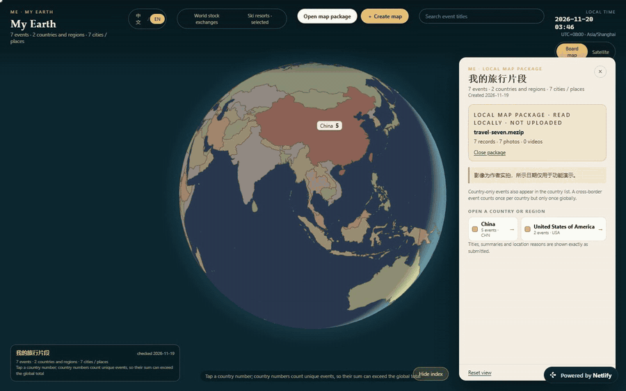

# ME · My Earth

Explore ready-made 3D globes of places worth knowing, or ask an agent to turn your own places, photos and short videos into an interactive map package that stays on your machine and exports a slide-ready image.

| **[Explore the globe →](https://me-interest-globe.netlify.app/?lang=en&welcome=0)** | **[Try the travel photo map →](#try-the-travel-photo-map)** | **[Make one with your agent →](#make-one-with-your-agent)** |
| --- | --- | --- |
| Open the live site and start with the **World stock exchanges** topic. | See a real photo map in the viewer, download it, and follow the exact click path. | Copy one request for your agent, or install the local tool and build a package. |



From Suzhou to Chicago — open two places on my globe and see the photos I took there.

**[Download this travel map](https://github.com/junyisunme/me-my-earth/raw/main/examples/travel-seven/travel-seven.mezip)** · **[Open the viewer](https://me-interest-globe.netlify.app/?welcome=0&lang=en)**

## Explore the globe

The **v0.5.0** home page opens on **World stock exchanges**: **18** exchanges or operating companies across **17** city places, each with an official website and a coordinate-precision note (headquarters/trading floor or city level, stated per record). The second built-in topic is **Ski resorts · selected**: **12** resort/village bases in **12** countries and regions, placed at the base rather than the summit.

- [Open World stock exchanges](https://me-interest-globe.netlify.app/?topic=world-exchanges&lang=en&welcome=0)
- [Open Ski resorts](https://me-interest-globe.netlify.app/?topic=ski-resorts&lang=en&welcome=0)

Country browsing stays on the 3D globe. Click a country, open a record, then click the sea or blank space outside the globe to return to the world view; drag to keep the current country and rotate the sphere. The header has a **中文 / EN** switch.

## Try the travel photo map

The GIF above is this same package opened in the ME viewer: Suzhou first, then a real drag across the Pacific to Chicago. The package also contains Shanghai, with its own demo date; the other five records have no date.

**1. Download the seven-photo map**  
[Download `travel-seven.mezip`](https://github.com/junyisunme/me-my-earth/raw/main/examples/travel-seven/travel-seven.mezip) — 7 records / 7 photos / no video.

**2. Open the ME viewer**  
Open the [English ME viewer](https://me-interest-globe.netlify.app/?welcome=0&lang=en), click **Open map package**, and choose the file you just downloaded. Then click **China** → **Suzhou** → the photo thumbnail.

Viewing this example needs only a browser — **no Node.js and no agent**. Photos are read locally by the browser; opening the package does not upload media to ME.

The Suzhou photo is the view from the entrance of Kempinski Hotel Jinji Lake toward the Gate of the Orient. The Shanghai photo looks from Shanghai World Financial Center toward Jin Mao Tower. Suzhou (`2024-05-01`) and Shanghai (`2024-05-02`) carry clearly labelled **demo dates**; the other five records are undated. Photos © 2026 Sun Junyi — these processed copies are used for this ME example, are not CC0 and are not covered by the API-example or code licence. [Full photos, city notes and dates →](examples/travel-seven/)

## Make one with your agent

Your agent needs two things: access to the **selected local files**, and the **place each photo or video belongs to**. ME does **not** identify where a photo was taken. If the place mapping is missing, the agent should ask for it instead of guessing.

Copy this request and the guide link to an agent that can read those local files and run commands:

```text
Use the ME guide at https://github.com/junyisunme/me-my-earth/blob/main/agent/README.md to turn my selected photos and short videos into an interactive globe, grouped by place. Give me a .mezip file I can open and a 16:9 PNG for my slides. Process the media locally.
```

Guide: [agent/README.md](agent/README.md) · Download: [`me-agent-0.5.0.zip`](https://github.com/junyisunme/me-my-earth/releases/download/v0.5.0/me-agent-0.5.0.zip)  
SHA-256: `9247314717631B70484213D4AD147403842391D149886FDA033AED7549AF5525` · Viewer: <https://me-interest-globe.netlify.app/?welcome=0>

The agent does **not** need the `earth` skill installed for this local media workflow; the public guide is the complete contract. It does need to be able to read the selected files and run `node`.

### Install me-agent 0.5.0

Requires **Node.js 24+**. The versioned installer verifies the Release SHA-256, installs to `me-agent-0.5.0`, and preserves existing `out/`, `.mezip`, PNG and media files in that directory.

**Windows (PowerShell)**

```powershell
$ErrorActionPreference = "Stop"
$installer = Join-Path $env:TEMP "me-agent-install.ps1"
Invoke-WebRequest -Uri "https://raw.githubusercontent.com/junyisunme/me-my-earth/main/agent/install.ps1" -OutFile $installer
& $installer
```

Then, in the same PowerShell window:

```powershell
Set-Location "$HOME\me-agent-0.5.0"
node .\me-agent.mjs build --brief .\examples\japan-cities\japan-cities.json --out-dir .\out --package-name japan-cities.mezip --slide
```

**macOS / Linux**

```bash
curl -L --fail -o /tmp/me-agent-install.sh \
  https://raw.githubusercontent.com/junyisunme/me-my-earth/main/agent/install.sh
bash /tmp/me-agent-install.sh
cd ~/me-agent-0.5.0
node me-agent.mjs build --brief examples/japan-cities/japan-cities.json --out-dir out --package-name japan-cities.mezip --slide
```

Either platform produces the same files:

```text
out/japan-cities.mezip
out/japan-cities-slide-16x9.png
out/japan-cities-report.json
```

Open `out/japan-cities.mezip` in the [ME viewer](https://me-interest-globe.netlify.app/?welcome=0) with **Open map package**. The Japan sample is only a build test: it has a synthetic Kyoto photo and the CC0 MDN `flower.mp4` test clip (labelled as a test video), not travel footage. The seven-photo `travel-seven.mezip` above is a finished map and needs no build.

## API and agent workflows

- **Public text maps** (places, rankings, trips) use `POST /api/maps`; a public link is created only on an explicit publish request. See the [API guide](docs/API.md) and [Agent workflows](docs/AGENT_WORKFLOWS.md).
- **Photos or video** go through the local `me-agent` tool above. A `.mezip` can contain private media: do not upload it, attach it to a public map, or commit it to a public repository without the user’s permission.

## More example maps

| Map | Open |
| --- | --- |
| Guitar shops · 5 | [Open](https://me-interest-globe.netlify.app/?map=2FRcS4HqKPwD037cyL63ZK_n&lang=en&welcome=0) |
| Oil regions · 8 | [Open](https://me-interest-globe.netlify.app/?map=nMaS9Wsvb0h6-CYdJ9iXUZ3E&lang=en&welcome=0) |
| QS 2027 top 100 · legacy | [Open](https://me-interest-globe.netlify.app/?map=5_sK-fhDyYpuTLldqT3wqvnc&lang=en&welcome=0) |
| Ski resorts · legacy map | [Open](https://me-interest-globe.netlify.app/?map=0rbCDSfP_OyKwkvhMI6yza9D&lang=en&welcome=0) |

The legacy QS map is a user-built top-100 visualization, separate from the retired built-in QS topic. Its old links and wallpaper project are preserved.

## Desktop wallpaper

Already made a globe? Ask your agent to set it as your Windows desktop wallpaper.

The [Lively project](wallpapers/lively/qs-2027/) and [Wallpaper Engine project](wallpapers/wallpaper-engine/qs-2027/) remain available. Apply a wallpaper only when the user explicitly asks; see the [wallpaper notes](docs/WALLPAPER_ENGINE.md).

## Make a public text map

Start with the five Japanese guitar shops in [`examples/guitar-five.json`](examples/guitar-five.json). Upload it at the [create page](https://me-interest-globe.netlify.app/?welcome=0&lang=en), or post the same file:

```bash
curl -L -o guitar-five.json \
  https://raw.githubusercontent.com/junyisunme/me-my-earth/main/examples/guitar-five.json

curl -X POST "https://me-interest-globe.netlify.app/api/maps" \
  -H "Content-Type: application/json" \
  --data-binary @guitar-five.json
```

The response contains `shareUrl`, `eventCount`, `countryCount`, `cityCount`, `previewImageUrl` and `coverStatus`. A failed cover does not invalidate the map; do not resubmit and create a duplicate.

## Repository contents

This is the public product page, API guide, examples and Agent integrations. The application source, data pipeline and internal test suite are maintained privately.

- [Travel example](examples/travel-seven/)
- [me-agent guide](agent/README.md)
- [API guide](docs/API.md)
- [Agent workflows](docs/AGENT_WORKFLOWS.md)
- [earth skill](.claude/skills/earth/SKILL.md)
- [Wallpaper notes](docs/WALLPAPER_ENGINE.md)
- [Downloads](downloads/) · [Assets](assets/)

**My Earth is created by Sun Junyi.** Data sources and linked pages keep their own attribution and terms.
