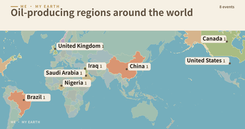

# ME · My Earth

**Turn the places you care about into an interactive globe you can share.**

ME turns a list, a ranking or a field notebook into a globe you can explore. Pick a country, open a marker, and see why that place is on the map — with the original source one tap away.

**Where are the world’s top-ranked universities? Pick a country and explore.**

<a href="https://6afc8b581813239311ea1a4d--me-interest-globe.netlify.app/?map=5_sK-fhDyYpuTLldqT3wqvnc&lang=en&welcome=0">
  
</a>

**[Explore the QS 2027 globe →](https://6afc8b581813239311ea1a4d--me-interest-globe.netlify.app/?map=5_sK-fhDyYpuTLldqT3wqvnc&lang=en&welcome=0)** · **Live preview** · **[Create a map with your agent →](#for-agents)**

This is a user-built **QS 2027 top-100 map**, separate from the built-in QS 2027 top-50 topic on the site. It has **100 map records** covering **102 universities**. The QS source snapshot names **23 countries and regions**; the globe groups China into one entry, so the display hierarchy has **21 countries and regions**. Two tied records each group two schools so the top-100 line stays within the 100-record limit. Pick a country to see its schools, then open a record to read the rank, score and QS source.

**Data source:** [QS World University Rankings 2027 — official ranking](https://www.topuniversities.com/world-university-rankings). This is a user-built visualization, not an official QS product.

## Explore more maps

<a href="https://6afc8b581813239311ea1a4d--me-interest-globe.netlify.app/?map=0rbCDSfP_OyKwkvhMI6yza9D&lang=en&welcome=0">
  
</a>

**Ski resorts around the world** — twelve resort bases in twelve countries, from Chamonix to Thredbo and Coronet Peak. The points are placed at resort bases, not at the nearest big city.  
**[Explore the ski map →](https://6afc8b581813239311ea1a4d--me-interest-globe.netlify.app/?map=0rbCDSfP_OyKwkvhMI6yza9D&lang=en&welcome=0)** · **Live preview**

<a href="https://6afc8b581813239311ea1a4d--me-interest-globe.netlify.app/?map=nMaS9Wsvb0h6-CYdJ9iXUZ3E&lang=en&welcome=0">
  
</a>

**Oil-producing regions around the world** — eight geographic entries, including onshore fields, offshore basins, oil sands and a UK–Norway North Sea record linked at country level. It is a geographic guide, not a production ranking.  
**[Explore the oil map →](https://6afc8b581813239311ea1a4d--me-interest-globe.netlify.app/?map=nMaS9Wsvb0h6-CYdJ9iXUZ3E&lang=en&welcome=0)** · **Live preview**

## Make your first map

Start with the five Japanese vintage guitar shops in [`examples/guitar-five.json`](examples/guitar-five.json). The file is public and small enough to inspect.

**[Download the sample JSON](https://raw.githubusercontent.com/junyisunme/me-my-earth/main/examples/guitar-five.json)** · [Open the create page](https://6afc8b581813239311ea1a4d--me-interest-globe.netlify.app/?welcome=0&lang=en) and choose **Create map**.

1. **Upload** the JSON.
2. **Create** the map.
3. **Get a cover and a share link** — the expected result is **3 shops in Tokyo** and **2 in Osaka**.

<a href="https://6afc8b581813239311ea1a4d--me-interest-globe.netlify.app/?welcome=0&lang=en">
  
</a>

The sample uses the same public `POST /api/maps` contract as every other map. You can edit the JSON, replace the events and keep the structure.

## For agents

Copy this prompt into an agent that can browse and call HTTP APIs:

```text
Use https://github.com/junyisunme/me-my-earth to build a map for me.
Theme: five vintage guitar shops in Japan.
Follow the repository's "For agents" instructions and create the map from the public sample JSON. The expected result is 5 shops, with 3 in Tokyo and 2 in Osaka.
Return the cover image and the share link. If you cannot submit directly, give me a downloadable JSON file I can upload myself.
```

A text-based agent can submit the same public file without a browser:

```bash
curl -L -o guitar-five.json \
  https://raw.githubusercontent.com/junyisunme/me-my-earth/main/examples/guitar-five.json

curl -X POST "https://6afc8b581813239311ea1a4d--me-interest-globe.netlify.app/api/maps" \
  -H "Content-Type: application/json" \
  --data-binary @guitar-five.json
```

The response contains:

```json
{
  "mapId": "…",
  "shareUrl": "https://…/?map=…",
  "eventCount": 5,
  "countryCount": 1,
  "cityCount": 2,
  "previewImageUrl": "https://…/api/covers/v2/….png",
  "coverStatus": "ready"
}
```

- **`shareUrl`** is the interactive map. It always works even if the cover fails.
- **`previewImageUrl`** is a public 1200×630 PNG that can be shown directly in a chat reply.
- If `coverStatus` is `"failed"`, show the map link instead of a broken image; the map has already been saved. Do not resubmit and create a duplicate.
- A chat assistant that can only produce a file can hand the JSON to the user and use the [web upload page](https://6afc8b581813239311ea1a4d--me-interest-globe.netlify.app/?welcome=0&lang=en).

**[Full API fields and sample →](docs/API.md)**

### Reusing the API examples

You may copy and modify the original API call examples in this repository to connect to ME. This permission applies only to those original call examples.

## About

**Created by Sun Junyi.** Product design, data representation and acceptance testing. Built with assistance from DeepSeek Harness for implementation and testing.

ME is meant to make a small, personal collection of places feel like a globe rather than a spreadsheet: one marker, one reason, one source, one shareable link.

Have a question, found a bad location or want to suggest the next map? **[Open a GitHub Issue →](https://github.com/junyisunme/me-my-earth/issues)**

## What is inside this repository

This is the public product page: the live map links, covers, the downloadable first-map example and the public API guide. The application source, data pipeline and internal test suite are maintained separately.

- [QS 2027 map](https://6afc8b581813239311ea1a4d--me-interest-globe.netlify.app/?map=5_sK-fhDyYpuTLldqT3wqvnc&lang=en&welcome=0)
- [Ski resorts map](https://6afc8b581813239311ea1a4d--me-interest-globe.netlify.app/?map=0rbCDSfP_OyKwkvhMI6yza9D&lang=en&welcome=0)
- [Oil regions map](https://6afc8b581813239311ea1a4d--me-interest-globe.netlify.app/?map=nMaS9Wsvb0h6-CYdJ9iXUZ3E&lang=en&welcome=0)
- [Public API guide](docs/API.md)
- [Downloadable guitar-shop sample](examples/guitar-five.json)
- [Issues and feedback](https://github.com/junyisunme/me-my-earth/issues)

The live preview is a Deploy Preview, not the stable production site. The stable site currently hosts an earlier version.
