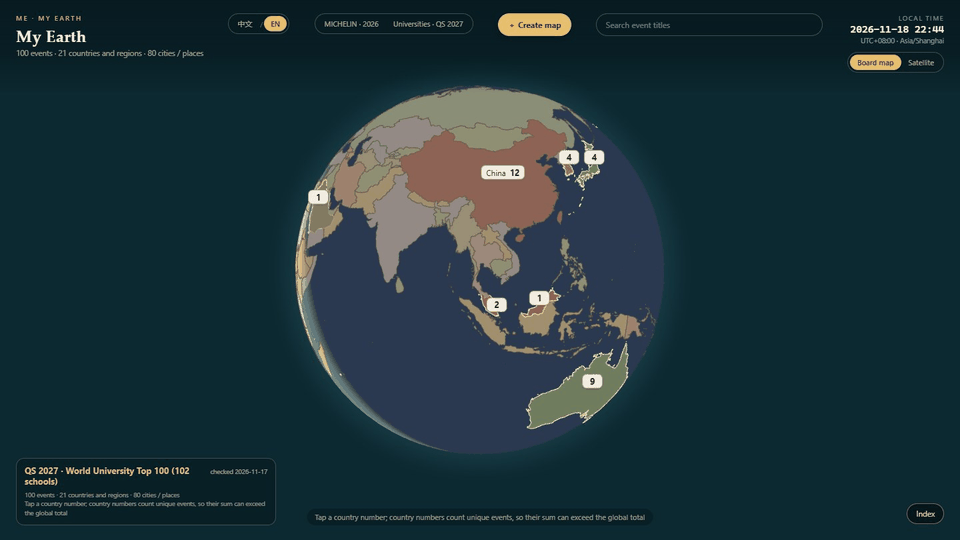
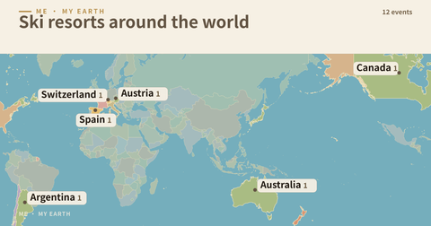
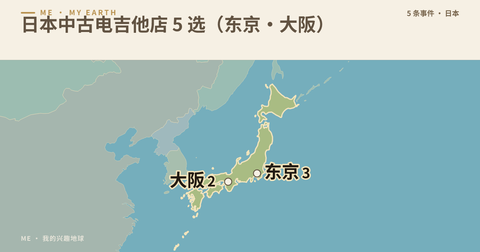

# ME · My Earth

**Turn the places you care about into an interactive globe you can share.**

ME turns a list, a ranking or a field notebook into a globe you can explore. Pick a country, open a marker, and see why that place is on the map — with the original source one tap away.

**[Example maps](examples/)** · **[Agent workflows](docs/AGENT_WORKFLOWS.md)** · **[Desktop wallpaper](#desktop-wallpaper)** · **[Presentation](#presentation)**

## For Agents

If you are an agent, start with **[Agent workflows](docs/AGENT_WORKFLOWS.md)** and the **[installation and call guide](agent/README.md)**.

- **Public text map** (places, rankings, trips): use the `earth` skill in Claude Code / Cursor, or the `dsh-plugin-my-earth` plugin in DeepSeek Harness. A public link is created only when the user explicitly asks to publish.
- **Selected photos / video**: use the local `me-agent` tool. It builds a `.mezip`, a 16:9 PNG and a Lively project without uploading the media.
- **No local execution**: say so and do not pretend a local `.mezip` or wallpaper was created.

The machine-readable delivery contract, privacy rules and DSH commands are in [`agent/README.md`](agent/README.md) and [`docs/AGENT_WORKFLOWS.md`](docs/AGENT_WORKFLOWS.md).

## DeepSeek Harness

Install the public `dsh-plugin-my-earth` plugin, then ask in words — no hand-written API call:

**GUI:** **Plugins → Add plugin** → paste:

```text
github:junyisunme/dsh-plugin-my-earth#v0.1.1
```

**CLI:**

```sh
dsh plugin --profile <profile> add github:junyisunme/dsh-plugin-my-earth#v0.1.1
```

The plugin exposes `create_map`. It posts to the public ME API only when the user explicitly asks for a public share link; drafts stay local. Example prompt:

```text
把京都、东京、大阪的五个地点做成一张地图，并生成公开分享链接
```

The current plugin version is verified against DSH `0.2.2-rc.3`; the tool appears in the next session after installation. Details: <https://github.com/junyisunme/dsh-plugin-my-earth#安装>.


<a href="https://me-interest-globe.netlify.app/?map=5_sK-fhDyYpuTLldqT3wqvnc&lang=en&welcome=0">
  
</a>

*9-second demo recorded from the live QS 2027 map on 2026-11-18: rotate the globe → pick Singapore → open NUS. The QS source stays visible in the detail panel.*

**[Try the QS map](https://me-interest-globe.netlify.app/?map=5_sK-fhDyYpuTLldqT3wqvnc&lang=en&welcome=0)** · **[Build a map from your own data](https://me-interest-globe.netlify.app/?welcome=0&lang=en)**

**Claude Code / Cursor:** [install the `earth` skill](docs/SKILL.md) · **DeepSeek Harness:** [install the `dsh-plugin-my-earth` plugin](https://github.com/junyisunme/dsh-plugin-my-earth#安装) · **Photos + video:** [install `me-agent`](agent/README.md)

## Photos, video and slide exports

[`me-agent`](agent/README.md) turns selected photos, a short video and place records into a local `.mezip`, a 16:9 slide PNG, and a Lively wallpaper project. It runs on the user's machine; media is not uploaded, and a public map link is never created unless the user explicitly asks for one.

```bash
# download me-agent-0.3.0.zip from Releases, then:
node me-agent.mjs build --brief examples/japan-cities/japan-cities.json \
  --out-dir out --package-name japan-cities.mezip --slide
```

Open the result in the [ME viewer](https://me-interest-globe.netlify.app/?welcome=0) with **打开地图包**. Windows users can then run `node me-agent.mjs desktop --package out/japan-cities.mezip --apply` to set the same map as a Lively wallpaper.

**[Download the release](https://github.com/junyisunme/me-my-earth/releases/download/v0.3.0/me-agent-0.3.0.zip)** · **[Agent instructions](agent/README.md)** · **[Example](agent/examples/japan-cities/)**


<details>
<summary><b>Install <code>/earth</code> — Claude Code / Cursor</b></summary>

Both clients read the same personal skill file. Install it once, then use `/earth` in either client.

**Bash**

```bash
mkdir -p ~/.claude/skills/earth
curl -L --fail --silent --show-error \
  -o ~/.claude/skills/earth/SKILL.md \
  https://raw.githubusercontent.com/junyisunme/me-my-earth/main/.claude/skills/earth/SKILL.md
```

**Windows PowerShell**

```powershell
$ErrorActionPreference = "Stop"
$dir = Join-Path $env:USERPROFILE ".claude\skills\earth"
New-Item -ItemType Directory -Force -Path $dir | Out-Null
$file = Join-Path $dir "SKILL.md"
curl.exe --fail --silent --show-error --location --output $file `
  "https://raw.githubusercontent.com/junyisunme/me-my-earth/main/.claude/skills/earth/SKILL.md"
if ($LASTEXITCODE -ne 0) { throw "Skill download failed (curl exit $LASTEXITCODE)" }
```

Try it:

```text
/earth 把这五家日本古董吉他店做成一张地图，并生成公开分享链接
```

Drafts stay local: ask for “整理成草稿” and the skill writes JSON without publishing. It calls the public API only when you explicitly ask for a share link.

Full install, verification and pending items: [`docs/SKILL.md`](docs/SKILL.md)

</details>

This is a user-built **QS 2027 top-100 map**, separate from the built-in QS 2027 top-50 topic on the site. It has **100 map records** covering **102 universities**. The QS source snapshot names **23 countries and regions**; the globe groups China into one entry, so the display hierarchy has **21 countries and regions**. Two tied records each group two schools so the top-100 line stays within the 100-record limit. Pick a country to see its schools, then open a record to read the rank, score and QS source.

**Data source:** [QS World University Rankings 2027 — official ranking](https://www.topuniversities.com/world-university-rankings). This is a user-built visualization, not an official QS product.

## Example maps

Four maps you can open right now — the QS 2027 globe above, twelve ski resorts, eight
oil-producing regions, and five vintage guitar shops in Japan. Each cover opens the
interactive map.

<table width="100%">
  <tr>
    <td width="50%" valign="top">
      <a href="https://me-interest-globe.netlify.app/?map=5_sK-fhDyYpuTLldqT3wqvnc&lang=en&welcome=0"></a>
      <sub><b>QS 2027</b> · World University Top 100</sub>
    </td>
    <td width="50%" valign="top">
      <a href="https://me-interest-globe.netlify.app/?map=0rbCDSfP_OyKwkvhMI6yza9D&lang=en&welcome=0"></a>
      <sub><b>Ski resorts</b> · twelve countries</sub>
    </td>
  </tr>
  <tr>
    <td width="50%" valign="top">
      <a href="https://me-interest-globe.netlify.app/?map=nMaS9Wsvb0h6-CYdJ9iXUZ3E&lang=en&welcome=0"></a>
      <sub><b>Oil regions</b> · eight geographic entries</sub>
    </td>
    <td width="50%" valign="top">
      <a href="https://me-interest-globe.netlify.app/?map=jfAgs96uMi02v65ipLSfCF4l&lang=en&welcome=0"></a>
      <sub><b>Guitar shops</b> · 3 Tokyo, 2 Osaka</sub>
    </td>
  </tr>
</table>

**[Open the detailed example pages →](examples/)** · **[Download the guitar-shop JSON](https://raw.githubusercontent.com/junyisunme/me-my-earth/main/examples/guitar-five.json)**

## Desktop wallpaper

**Trial Deploy Preview only.** `display=wallpaper` requires a deployment that supports it.
Use this full address as-is; a normal share link does not include the wallpaper layout.

<https://6afd84eacabd8cf0c94443a1--me-interest-globe.netlify.app/?map=5_sK-fhDyYpuTLldqT3wqvnc&lang=en&welcome=0&display=wallpaper>

- **Lively Wallpaper** — import [`wallpapers/lively/qs-2027/`](wallpapers/lively/qs-2027) and choose `index.html`. Do not paste the URL into Lively’s URL field; it drops the query string.
- **Wallpaper Engine 2.8.42** — import [`wallpapers/wallpaper-engine/qs-2027/`](wallpapers/wallpaper-engine/qs-2027). Use **Open wallpaper** → `project.json`, or the editor with `index.html`; if the preview is blank, use **View → Restart preview**.

<details>
<summary><b>Known limitations &amp; test report</b></summary>

- The Windows test (Wallpaper Engine 2.8.42, 2560×1440) did not zoom with the mouse wheel.
- Singapore → NUS was opened through the desktop page’s DOM, not a physical click on the NUS dot.
- Native Safari and Plash remain untested on a real Mac.
- Full report: [`docs/WALLPAPER_ENGINE.md`](docs/WALLPAPER_ENGINE.md). Sanitized screenshots: [`wallpaper-engine-globe.png`](assets/wallpaper-engine-globe.png), [`wallpaper-engine-nus.png`](assets/wallpaper-engine-nus.png), [`wallpaper-engine-editor.png`](assets/wallpaper-engine-editor.png).

</details>

## Presentation

- [PPTX — QS 2027 demo](downloads/me-my-earth-qs-2027-demo.pptx)
- [PDF — same deck with URI links](downloads/me-my-earth-qs-2027-demo.pdf)
- [1200×630 cover PNG](assets/qs-2027-cover-v2.png)

The deck opens the **normal interactive map**, not the wallpaper layout:

<https://me-interest-globe.netlify.app/?map=5_sK-fhDyYpuTLldqT3wqvnc&lang=en&welcome=0>

**Canva:** upload the PNG as a full-page/cover image, then add the same interactive map link to the image; verify the link inside Canva.

Platform status: the PPTX/PDF link structure is verified (relationships + PDF `/URI` annotations point to the same URL); PowerPoint desktop is not installed here and PowerPoint web was not tested; Canva has no account on this machine, so the PNG + URL are provided but not clicked in Canva. The demo steps are Singapore → NUS (rank 10) or NTU.

## Make your first map

Start with the five Japanese vintage guitar shops in [`examples/guitar-five.json`](examples/guitar-five.json). The file is public and small enough to inspect. It is the same JSON behind the guitar map on the [example maps](examples/) page.

**[Download the sample JSON](https://raw.githubusercontent.com/junyisunme/me-my-earth/main/examples/guitar-five.json)** · [Open the create page](https://me-interest-globe.netlify.app/?welcome=0&lang=en) and choose **Create map**.

1. **Upload** the JSON.
2. **Create** the map.
3. **Get a cover and a share link** — the expected result is **3 shops in Tokyo** and **2 in Osaka**.

The sample uses the same public `POST /api/maps` contract as every other map. You can edit the JSON, replace the events and keep the structure. [Full example walkthrough →](examples/README.md#download-edit-and-re-upload-the-json)

## Agent workflows

Read **[docs/AGENT_WORKFLOWS.md](docs/AGENT_WORKFLOWS.md)** first. This repository is the public product page/showcase; it does **not** contain the application source or the local art-pack CLI. Pick one route:

| Intent | Start here | Output |
| --- | --- | --- |
| Install a map skill for Claude Code / Cursor | [Install the `earth` skill](docs/SKILL.md) | `/earth` in both clients |
| Open/share an existing map | [§1](docs/AGENT_WORKFLOWS.md#1-打开或分享现有地图) | normal map URL |
| Put a map on the desktop | [§2](docs/AGENT_WORKFLOWS.md#2-把地图放到桌面) | `display=wallpaper`, Lively / Wallpaper Engine imports |
| Put a map in a deck | [§3](docs/AGENT_WORKFLOWS.md#3-把地图放进演示) | PPTX / PDF / PNG + normal map link |
| Create a new map | [§4](docs/AGENT_WORKFLOWS.md#4-新建一张用户地图) | `?map=<mapId>` + cover |
| Change icons/palette | [§5](docs/AGENT_WORKFLOWS.md#5-换图标--配色公开示例) | public `me-art-pack-1` example; local run requires the app source |

The public art-pack example is [`examples/art-packs/qs-warm-paper/`](examples/art-packs/qs-warm-paper); the full local `import → preview → restore → export/re-import → publish` flow runs in the application repository, not this showcase. See [`docs/ART_PACKS.md`](docs/ART_PACKS.md).

## For agents

Install the [`earth` skill](docs/SKILL.md) in Claude Code or Cursor, then ask “把这五家日本古董吉他店做成一张地图” or *“make a map of these places”*. The skill reads the sample JSON, calls the public API, and returns the map link and cover.

For a list of your own places, say “整理成草稿” to get a local JSON draft with **no upload**, or “生成公开分享链接” to publish it **once**. Published maps are public by link; the skill will not publish a draft on its own.

Any agent that can browse and call HTTP APIs can do the same with this prompt:

```text
Use https://github.com/junyisunme/me-my-earth to build a map for me.
Theme: five vintage guitar shops in Japan.
Follow the repository's "For agents" instructions and create the map from the public sample JSON. The expected result is 5 shops, with 3 in Tokyo and 2 in Osaka.
Return the cover image and the share link. If you cannot submit directly, give me a downloadable JSON file I can upload myself.
```

A text-based agent can submit the same public file without a browser:

```bash
curl -L -o guitar-five.json \
  https://raw.githubusercontent.com/junyisunme/me-my-earth/main/examples/guitar-five.json

curl -X POST "https://me-interest-globe.netlify.app/api/maps" \
  -H "Content-Type: application/json" \
  --data-binary @guitar-five.json
```

The response contains:

```json
{
  "mapId": "…",
  "shareUrl": "https://…/?map=…",
  "eventCount": 5,
  "countryCount": 1,
  "cityCount": 2,
  "previewImageUrl": "https://…/api/covers/v2/….png",
  "coverStatus": "ready"
}
```

- **`shareUrl`** is the interactive map. It always works even if the cover fails.
- **`previewImageUrl`** is a public 1200×630 PNG that can be shown directly in a chat reply.
- If `coverStatus` is `"failed"`, show the map link instead of a broken image; the map has already been saved. Do not resubmit and create a duplicate.
- A chat assistant that can only produce a file can hand the JSON to the user and use the [web upload page](https://me-interest-globe.netlify.app/?welcome=0&lang=en).

**[Full API fields and sample →](docs/API.md)**

### Reusing the API examples

You may copy and modify the original API call examples in this repository to connect to ME. This permission applies only to those original call examples.

## About

**My Earth is created by Sun Junyi.** The application Core is maintained privately; this
repository is the public product page, API guide, examples and Agent integrations.

The public map API is open for agents and tools to build on. Collaborators with a concrete
plan are welcome to get in touch through the [issue tracker](https://github.com/junyisunme/me-my-earth/issues);
please include the use case and scope.

Public components keep their existing terms: the original API call examples may be copied and
modified under the permission in [Reusing the API examples](#reusing-the-api-examples), the
art-pack example’s icon is CC0 as stated in its [`SOURCE.md`](examples/art-packs/qs-warm-paper/SOURCE.md),
and the DSH plugin is MIT in its [own repository](https://github.com/junyisunme/dsh-plugin-my-earth).
Data sources and linked pages keep their own attribution and terms.

ME is meant to make a small, personal collection of places feel like a globe rather than a
spreadsheet: one marker, one reason, one source, one shareable link.

Have a question, found a bad location or want to suggest the next map?
**[Open a GitHub Issue →](https://github.com/junyisunme/me-my-earth/issues)**

## What is inside this repository

This is the public product page: the live map links, covers, desktop wallpaper imports, presentation downloads, the example maps, the downloadable first-map example, the `earth` skill and the public API guide. The application source, data pipeline and internal test suite are maintained separately.

- [Example maps](examples/) — QS 2027, ski resorts, oil regions, five guitar shops
- [QS 2027 map](https://me-interest-globe.netlify.app/?map=5_sK-fhDyYpuTLldqT3wqvnc&lang=en&welcome=0)
- [Ski resorts map](https://me-interest-globe.netlify.app/?map=0rbCDSfP_OyKwkvhMI6yza9D&lang=en&welcome=0)
- [Oil regions map](https://me-interest-globe.netlify.app/?map=nMaS9Wsvb0h6-CYdJ9iXUZ3E&lang=en&welcome=0)
- [`earth` skill for Claude Code and Cursor](docs/SKILL.md)
- [Public API guide](docs/API.md)
- [Downloadable guitar-shop sample](examples/guitar-five.json)
- [Agent workflows](docs/AGENT_WORKFLOWS.md)
- [Wallpaper Engine trial report](docs/WALLPAPER_ENGINE.md)
- [Lively wallpaper import](wallpapers/lively/qs-2027)
- [Wallpaper Engine import](wallpapers/wallpaper-engine/qs-2027)
- [Presentation downloads](downloads)
- [Art-pack example](examples/art-packs/qs-warm-paper)
- [Issues and feedback](https://github.com/junyisunme/me-my-earth/issues)

The live preview is a Deploy Preview, not the stable production site. The stable site currently hosts an earlier version.
