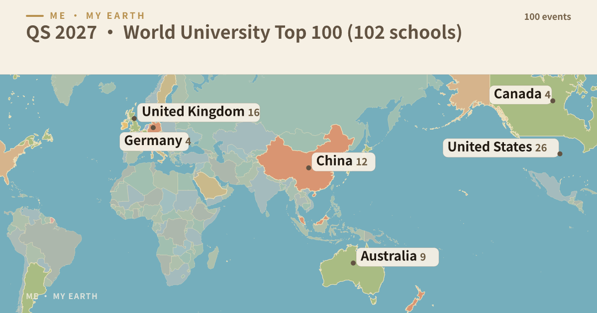
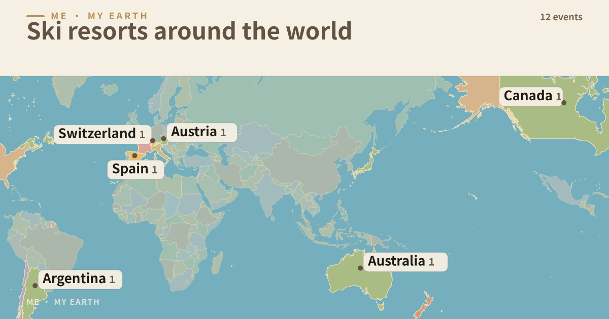
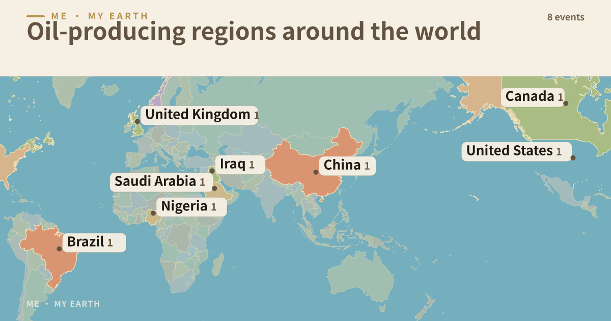
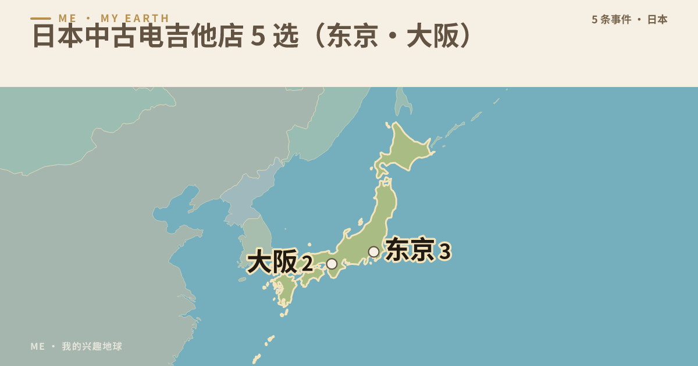

# Example maps

Four maps built with the public ME API. Every link opens the live globe — no account, no
API key, no install. Use them to see what a finished map looks like, or start from the guitar
JSON and make one of your own.

## QS 2027 — World University Top 100

A user-built map of the QS 2027 top 100: 100 records covering 102 universities, with the
ranking and the QS source inside every record.
**[Open the QS map →](https://me-interest-globe.netlify.app/?map=5_sK-fhDyYpuTLldqT3wqvnc&lang=en&welcome=0)**

What to try: pick **Singapore**, then open **NUS** (rank 10) and follow *Open original* to the
QS page. This is the flow shown in the README demo GIF.

## Ski resorts around the world

Twelve resort bases in twelve countries, from Chamonix to Thredbo and Coronet Peak — placed at
the resort base, not at the nearest big city.
**[Open the ski map →](https://me-interest-globe.netlify.app/?map=0rbCDSfP_OyKwkvhMI6yza9D&lang=en&welcome=0)**

## Oil-producing regions around the world

Eight geographic entries — onshore fields, offshore basins, oil sands and a UK–Norway North
Sea record linked at country level. A geographic guide, not a production ranking.
**[Open the oil map →](https://me-interest-globe.netlify.app/?map=nMaS9Wsvb0h6-CYdJ9iXUZ3E&lang=en&welcome=0)**

## Five vintage guitar shops in Japan

Five vintage guitar shops — three in Tokyo (Ochanomizu) and two in Osaka — each with its shop
page as the source.
**[Open the guitar map →](https://me-interest-globe.netlify.app/?map=jfAgs96uMi02v65ipLSfCF4l&lang=en&welcome=0)**

### Download, edit and re-upload the JSON

This map was created from [`guitar-five.json`](guitar-five.json) with `POST /api/maps`. The
file is small enough to read and edit.

**[Download the JSON](https://raw.githubusercontent.com/junyisunme/me-my-earth/main/examples/guitar-five.json)**
· [View it in the repository](guitar-five.json)

1. **Download** the file (or copy the contents).
2. **Edit** the `title` and the `events` array. Keep each `source.url` a real, direct page and
   each location a place you can verify. The field rules are in [`docs/API.md`](../docs/API.md).
3. **Re-upload** it at the [create page](https://me-interest-globe.netlify.app/?welcome=0&lang=en)
   and choose **Create map**.
4. **Get a new link and cover.** The expected first screen for the unedited file is **3 shops
   in Tokyo and 2 in Osaka**.

Re-uploading creates a **new** map with its own link; the example above is left untouched.
You can also skip the web page and post the file with `curl` — see [For agents](../README.md#for-agents).

Maps are public by link: anyone with the URL can open them and follow the sources. Do not
upload private addresses or unpublished data.

---

Build a map from your own list next: the [public API guide](../docs/API.md) or the
[`earth` skill](../docs/SKILL.md) for Claude Code and Cursor.
