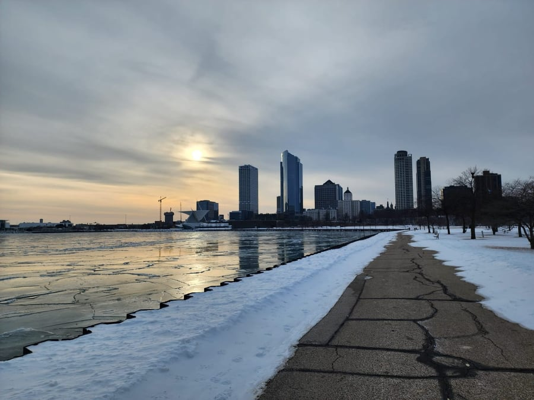
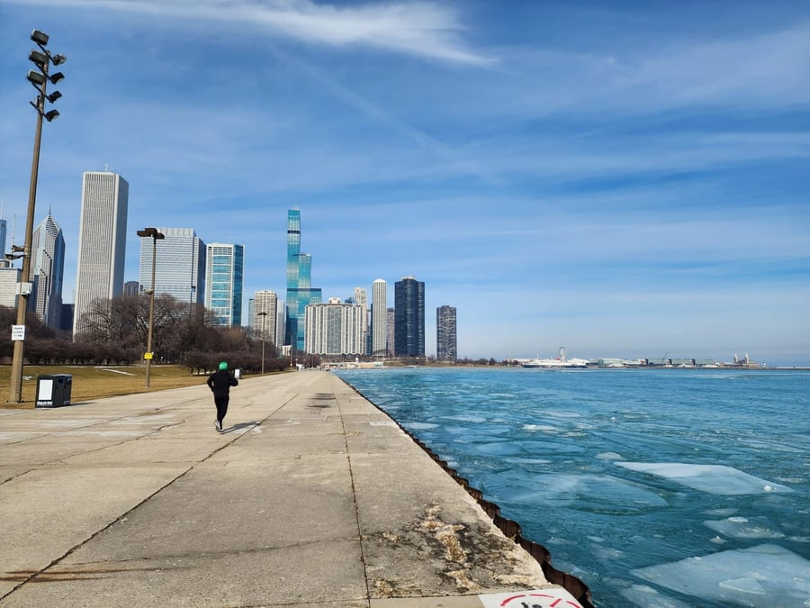
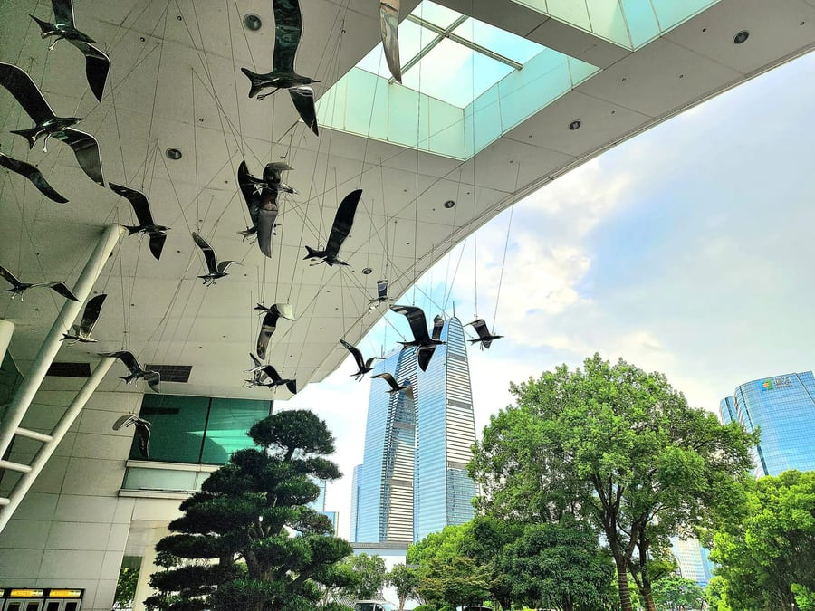
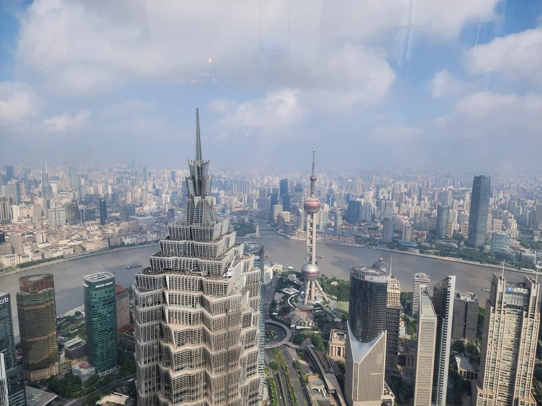
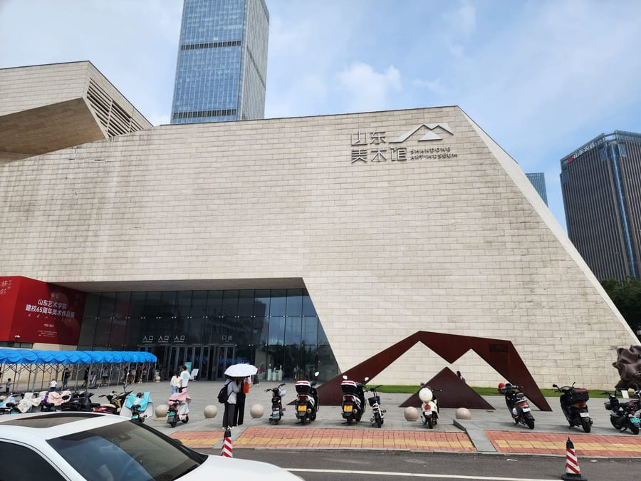
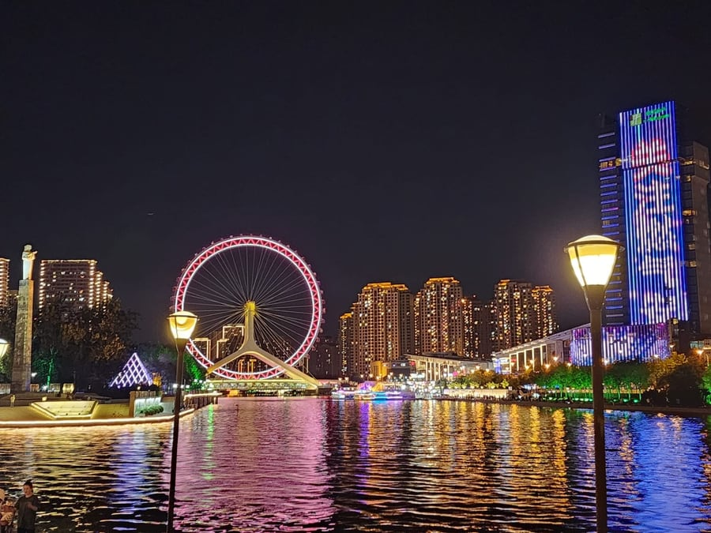
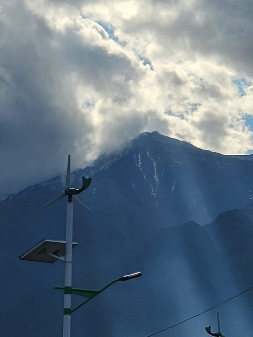

# My travel fragments · public photo example

This is a seven-record ME map package made from seven processed copies of the author’s own travel photos. The two short videos from the same private trip are **not** included.

**[Download `travel-seven.mezip`](travel-seven.mezip)** · **[Open the ME viewer](https://me-interest-globe.netlify.app/?welcome=0)**

1. Download the `.mezip`.
2. Open the viewer, choose **Open map package**, and select the downloaded file.
3. The photos are read locally by the browser; opening the package does not upload media to ME.

## Contents

- **7 records / 7 photos / 0 videos**
- Milwaukee, Chicago, Suzhou, Shanghai, Jinan, Tianjin and Dali
- Suzhou is marked at **Suzhou city level**; Shanghai is marked at **Shanghai World Financial Center**
- Dates: Suzhou `2024-05-01`, Shanghai `2024-05-02`; both are labelled **demo date**. The other five records have no date.
- Intro: “Photos are the author’s own; the dates shown are for feature demonstration only.”

The package contains only processed JPEG copies. It has no original ZIP, original WhatsApp filenames, local paths, EXIF/GPS or capture dates. The two private videos are deliberately absent.

## Photos and attribution

Photos © 2026 Sun Junyi. These processed copies are published specifically for this ME example and may be downloaded together with `travel-seven.mezip`. They are **not CC0**, are **not** covered by the API-example permission, and are **not** part of the code licence.

<table>
  <tr>
    <td width="33%"> US · Milwaukee</td>
    <td width="33%"> US · Chicago</td>
    <td width="33%"> China · Suzhou</td>
  </tr>
  <tr>
    <td width="33%"> China · Shanghai</td>
    <td width="33%"> China · Jinan</td>
    <td width="33%"> China · Tianjin</td>
  </tr>
  <tr>
    <td width="33%"> China · Dali</td>
    <td width="33%"></td>
    <td width="33%"></td>
  </tr>
</table>
